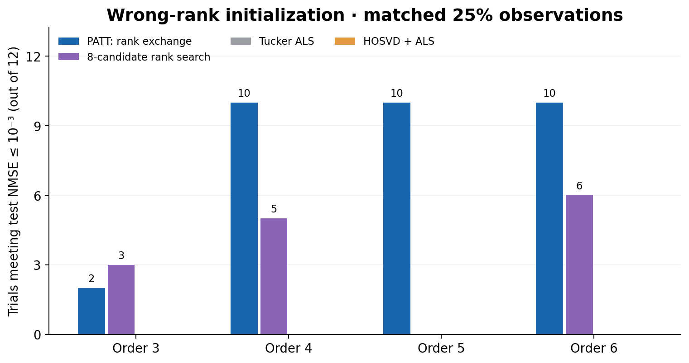
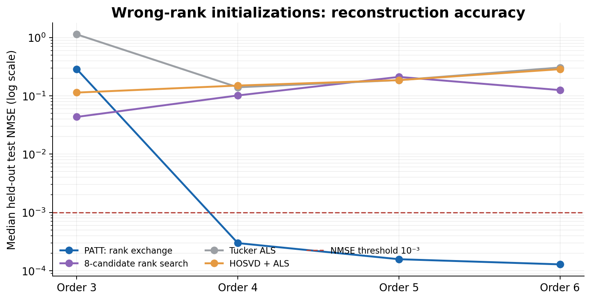
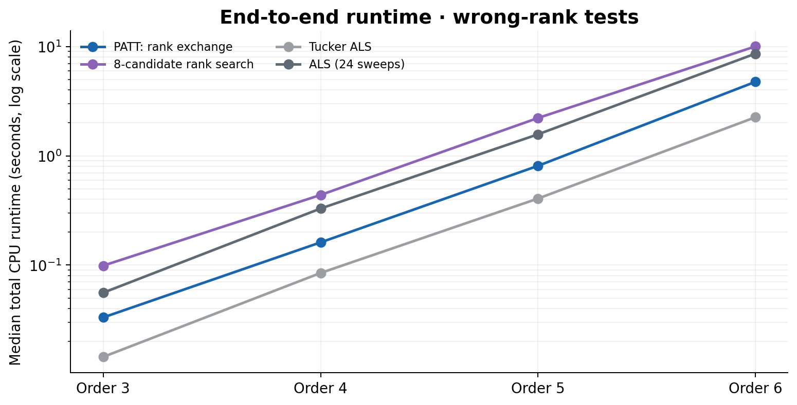
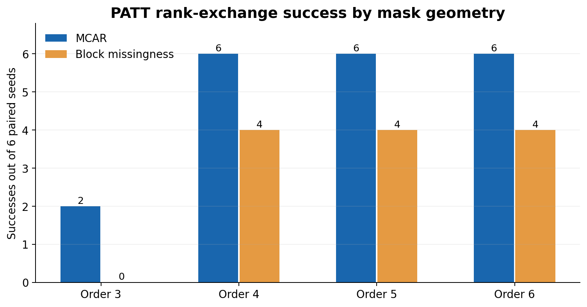
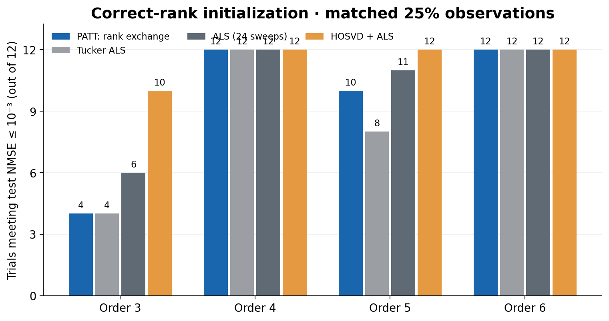
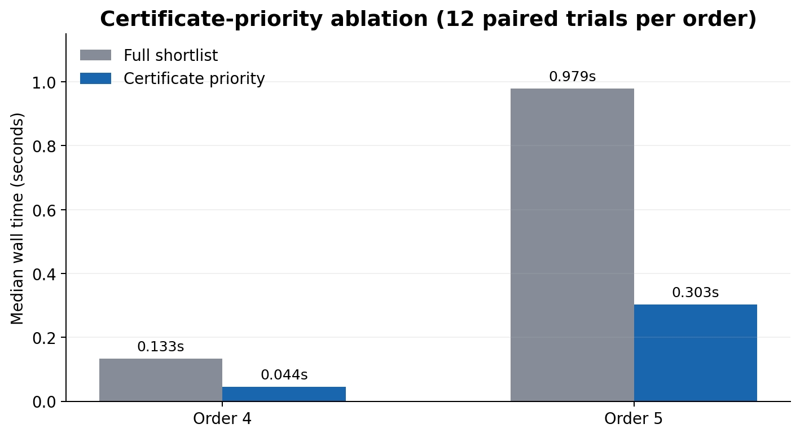
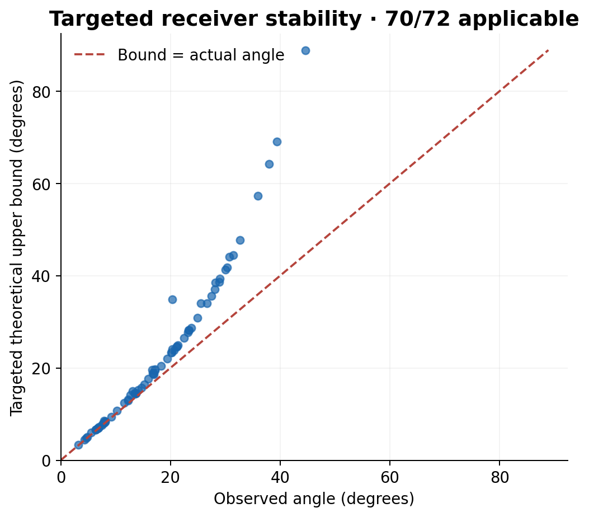
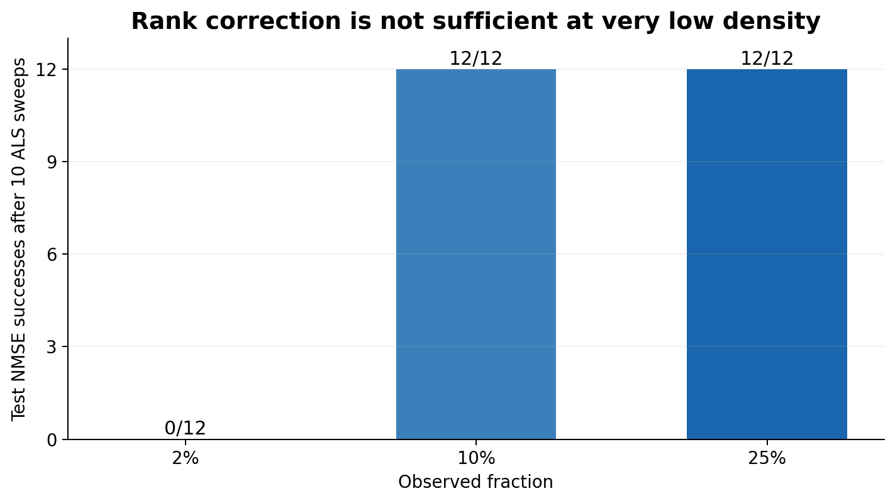
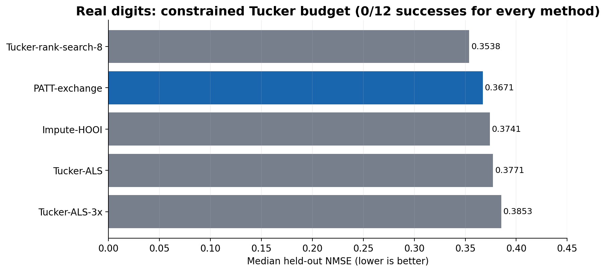

# PATT: Greedy Rank Reallocation for Tucker Tensor Completion

**Parallel Adaptive Tucker Tensor Completion (PATT)** · Python research implementation · fully reproducible numerical results · tensor orders 3–6

PATT is a **budget-aware greedy algorithm** that corrects an initially misallocated Tucker multilinear-rank budget by transferring rank from a donor mode to a receiver mode. It fits the core on the observed entries, ranks exchange candidates using masked residual information, refines candidates by Tucker ALS, and safeguards their acceptance. The implementation is a **serial CPU research prototype with parallelizable screening**, not a claim of realized GPU or universal parallel speedups.

**Primary criterion:** held-out normalized mean squared error (**test NMSE ≤ 10⁻³**); secondary criteria: CPU runtime, first validation-threshold crossing, parameter budget, and controlled algorithm comparisons.

> **Scope:** This repository reports measured results, including failures. It does **not** claim that Tucker rank is interchangeable with CP, TT, or tubal rank; that wrong-rank correction always succeeds; or that the independent Python ports are numerically equivalent to the MATLAB authors' code.



## At a glance

| Measurement | Recorded outcome |
| --- | --- |
| Main 25%-observed paired experiment | 432 executed method records |
| Synthetic tensor orders | 3, 4, 5, 6 |
| Main paired problem instances | 48 wrong-rank cases + 48 correct-rank controls |
| PATT successful on wrong-rank instances | **32/48** |
| PATT recovered correct allocated rank vector | **42/48** (not synonymous with NMSE success) |
| Eight-candidate Tucker rank search successful on wrong ranks | **14/48** |
| Fixed-rank Tucker-ALS successful on wrong ranks | **0/48** |
| Real-digit tensor controls reaching threshold | **0/60 method trials** |
| Translated TRAM/TMac trials at 25% | 336 (in supplementary table) |
| Translated TRAM/TMac trials across 10%, 25%, 40% | 528 (360 historical + 168 additional) |
| Certificate-priority vs original PATT test | 24 matched cases per method; both **23/24** successful |
| Receiver-stability theorem applicability | 70/72 diagnostic trials; 2 do not satisfy its sufficient condition |

**All figures above and below are plotted from the CSVs shipped in this repository.** Run `python reproduce_summary.py` to check main counts and `python plot_results.py` to regenerate the `chart_*.png` figures.

## 1. Main paired experiment: wrong Tucker ranks

The principal stress test begins with a **single deliberately misplaced Tucker rank** and compares methods under their recorded common problem setup, storage budget, observation mask, and seed. There are **12 problems per order** (six seeds × MCAR and block-missing masks), 25% training observation density, and five evaluated methods.

**Success counts at test NMSE ≤ 10⁻³**

| Algorithm | Order 3 | Order 4 | Order 5 | Order 6 | Total |
| --- | --- | --- | --- | --- | --- |
| PATT-rank-exchange | 2/12 | 10/12 | 10/12 | 10/12 | 32/48 |
| Tucker-rank-search-8 | 3/12 | 5/12 | 0/12 | 6/12 | 14/48 |
| Tucker-ALS | 0/12 | 0/12 | 0/12 | 0/12 | 0/48 |
| Tucker-ALS-24 | 0/12 | 0/12 | 0/12 | 0/12 | 0/48 |
| Tucker-HOSVD+ALS | 0/12 | 0/12 | 0/12 | 0/12 | 0/48 |





**Exact medians from the archived trial records**

| Order | Algorithm | Median test NMSE | Median total time (s) | Median validation time-to-target (s)* | Successes |
| --- | --- | --- | --- | --- | --- |
| 3 | PATT-rank-exchange | 0.287357 | 0.033 | 0.026 | 2/12 |
| 3 | Tucker-rank-search-8 | 0.043441 | 0.099 | 0.054 | 3/12 |
| 3 | Tucker-ALS | 1.131326 | 0.014 | — | 0/12 |
| 3 | Tucker-ALS-24 | 2.621096 | 0.056 | — | 0/12 |
| 3 | Tucker-HOSVD+ALS | 0.113619 | 0.020 | — | 0/12 |
| 4 | PATT-rank-exchange | 0.000297 | 0.161 | 0.153 | 10/12 |
| 4 | Tucker-rank-search-8 | 0.101446 | 0.439 | 0.309 | 5/12 |
| 4 | Tucker-ALS | 0.140015 | 0.085 | — | 0/12 |
| 4 | Tucker-ALS-24 | 0.150110 | 0.330 | — | 0/12 |
| 4 | Tucker-HOSVD+ALS | 0.149924 | 0.110 | — | 0/12 |
| 5 | PATT-rank-exchange | 0.000157 | 0.810 | 0.785 | 10/12 |
| 5 | Tucker-rank-search-8 | 0.210995 | 2.220 | — | 0/12 |
| 5 | Tucker-ALS | 0.185783 | 0.407 | — | 0/12 |
| 5 | Tucker-ALS-24 | 0.185501 | 1.573 | — | 0/12 |
| 5 | Tucker-HOSVD+ALS | 0.185626 | 0.533 | — | 0/12 |
| 6 | PATT-rank-exchange | 0.000128 | 4.753 | 4.555 | 10/12 |
| 6 | Tucker-rank-search-8 | 0.125322 | 10.024 | 8.722 | 6/12 |
| 6 | Tucker-ALS | 0.305786 | 2.253 | — | 0/12 |
| 6 | Tucker-ALS-24 | 0.290349 | 8.606 | — | 0/12 |
| 6 | Tucker-HOSVD+ALS | 0.286321 | 2.958 | — | 0/12 |

\* The reported validation time-to-target is the median over trials satisfying **both** the validation and test thresholds, where a crossing time was recorded; it is not an oracle test-time stopping rule. A dash means no qualifying observations.

The third-order results are a clear failure mode: PATT succeeds on only **2/12** instances, versus **3/12** for eight-candidate rank search. Fourth-, fifth-, and sixth-order synthetic wrong-rank cases are substantially more favorable to PATT. Runtime measurements are from the experimental CPU environment and are not guaranteed to transfer to different hardware.



**Pairwise threshold discordance against rank search** (two-sided exact McNemar p-values, no unreported multiple-testing correction):

| Order | PATT only | Rank search only | Both | Neither | Exact p |
| --- | --- | --- | --- | --- | --- |
| 3 | 2 | 3 | 0 | 7 | 1.000000 |
| 4 | 7 | 2 | 3 | 0 | 0.179688 |
| 5 | 10 | 0 | 0 | 2 | 0.001953 |
| 6 | 5 | 1 | 5 | 1 | 0.218750 |

## 2. Correct-rank control: why rank allocation matters

The very same problem construction is also run with correct allocated Tucker ranks. This control is crucial: when the ranks are already right, **standard HOSVD+ALS and ordinary Tucker ALS are highly competitive**. PATT's contribution is correcting wrong rank allocations, not replacing ALS on every problem.

**Success counts (test NMSE ≤ 10⁻³)**

| Algorithm | Order 3 | Order 4 | Order 5 | Order 6 | Total |
| --- | --- | --- | --- | --- | --- |
| PATT-rank-exchange | 4/12 | 12/12 | 10/12 | 12/12 | 38/48 |
| Tucker-ALS | 4/12 | 12/12 | 8/12 | 12/12 | 36/48 |
| Tucker-ALS-24 | 6/12 | 12/12 | 11/12 | 12/12 | 41/48 |
| Tucker-HOSVD+ALS | 10/12 | 12/12 | 12/12 | 12/12 | 46/48 |



**Correct-rank medians**

| Order | Algorithm | Median test NMSE | Median total time (s) | Median validation time-to-target (s)* | Successes |
| --- | --- | --- | --- | --- | --- |
| 3 | PATT-rank-exchange | 0.006221 | 0.025 | 0.014 | 4/12 |
| 3 | Tucker-ALS | 0.108463 | 0.015 | 0.013 | 4/12 |
| 3 | Tucker-ALS-24 | 0.000894 | 0.021 | 0.014 | 6/12 |
| 3 | Tucker-HOSVD+ALS | 0.000536 | 0.012 | 0.012 | 10/12 |
| 4 | PATT-rank-exchange | 0.000212 | 0.054 | 0.051 | 12/12 |
| 4 | Tucker-ALS | 0.000212 | 0.055 | 0.052 | 12/12 |
| 4 | Tucker-ALS-24 | 0.000212 | 0.054 | 0.051 | 12/12 |
| 4 | Tucker-HOSVD+ALS | 0.000396 | 0.043 | 0.040 | 12/12 |
| 5 | PATT-rank-exchange | 0.000269 | 0.287 | 0.260 | 10/12 |
| 5 | Tucker-ALS | 0.000385 | 0.269 | 0.251 | 8/12 |
| 5 | Tucker-ALS-24 | 0.000269 | 0.266 | 0.250 | 11/12 |
| 5 | Tucker-HOSVD+ALS | 0.000418 | 0.170 | 0.158 | 12/12 |
| 6 | PATT-rank-exchange | 0.000192 | 1.523 | 1.469 | 12/12 |
| 6 | Tucker-ALS | 0.000192 | 1.462 | 1.409 | 12/12 |
| 6 | Tucker-ALS-24 | 0.000192 | 1.433 | 1.379 | 12/12 |
| 6 | Tucker-HOSVD+ALS | 6.90e-05 | 1.135 | 1.074 | 12/12 |

## 3. Observation-density supplements (legacy seeds)

The separately collected 10% and 40% experiments have **different method coverage and fewer seeds** than the 25% primary paired experiment. Their sample counts should not be pooled as though they were independent replicas of the main design. The complete 336-record archive is `results_10pct_40pct.csv`.

PATT rank-exchange results:

| Rank setup | Observed | Order | Successes | Median test NMSE |
| --- | --- | --- | --- | --- |
| correct | 40% | 3 | 3/6 | 0.001823 |
| correct | 40% | 4 | 6/6 | 2.06e-05 |
| wrong | 10% | 3 | 0/6 | 10.652502 |
| wrong | 10% | 4 | 0/6 | 1.678978 |
| wrong | 40% | 3 | 2/6 | 0.008578 |
| wrong | 40% | 4 | 6/6 | 0.000115 |

## 4. Source-guided Python translations of published algorithms

The repository includes independently translated Python code for:

- **TRAM** — fixed/adaptive Tucker-manifold optimization; original MATLAB algorithm: [Gao–Peng–Yuan implementation](https://github.com/JimmyPeng1998/TRAM). The port applies to order-three tensors.
- **TMac** — alternating factorization of tensor mode unfoldings, with fixed, increasing and decreasing rank policies. This is **not the same Tucker-core objective** as PATT.
- **ARE** — a repaired image-specific adaptation of the [ARE repository](https://github.com/lymch/ARE); the released wrapper contained image-geometry assumptions and cannot be used unmodified for general-order tensor completion.

These are **source-guided independent translations**, not official MATLAB runs or numerically certified equivalents. Port-side safeguards and benchmark early stopping may differ. `results_ports_25pct.csv` includes all 336 paired 25%-observed translated-port runs; `results_ports_original_360.csv` and `raw_ports_additional_seeds.jsonl` retain the broader 528-run trial provenance.

**Success counts for the source-guided port methods at 25%:**

| Rank setup | Translated method | 3D | 4D | 5D | 6D | Total |
| --- | --- | --- | --- | --- | --- | --- |
| wrong | TRAM-adaptive | 0/12 | — | — | — | 0/12 |
| wrong | TRAM-fixed | 0/12 | — | — | — | 0/12 |
| wrong | TMac-fixed | 0/12 | 0/12 | 0/12 | 0/12 | 0/48 |
| wrong | TMac-inc | 0/12 | 0/12 | 0/12 | 0/12 | 0/48 |
| wrong | TMac-dec | 0/12 | 0/12 | 0/12 | 0/12 | 0/48 |
| correct | TRAM-adaptive | 6/12 | — | — | — | 6/12 |
| correct | TRAM-fixed | 4/12 | — | — | — | 4/12 |
| correct | TMac-fixed | 0/12 | 0/12 | 0/12 | 0/12 | 0/48 |
| correct | TMac-inc | 0/12 | 0/12 | 0/12 | 0/12 | 0/48 |
| correct | TMac-dec | 0/12 | 0/12 | 0/12 | 0/12 | 0/48 |

The poor TMac results are results for this **particular translation and experimental protocol**, not evidence that the original authors' implementations perform poorly in general. The published-code comparison must retain this provenance caveat.

## 5. A tested faster screening variant

A **certificate-priority** variant evaluates positive screened rank transfers before spending resources on expanded-core least-squares fits. This is a distinct measured variant, not retroactively part of the original PATT implementation.

| Order | Candidate evaluation | Successes | Median expanded-core fits | Median wall time (s) |
| --- | --- | --- | --- | --- |
| 4 | Original shortlist | 11/12 | 12 | 0.1331 |
| 4 | Certificate priority | 11/12 | 1 | 0.0442 |
| 5 | Original shortlist | 12/12 | 20 | 0.9792 |
| 5 | Certificate priority | 12/12 | 1 | 0.3027 |



The priority rule avoids many expanded-core fits on these favorable one-rank-misallocation cases. It does not establish a universal safe-pruning guarantee or a speedup for arbitrary rank-error patterns.

## 6. Mechanism verification, stability, and ALS refinement

The numerical diagnostics probe whether the theoretical operations actually used in the paper behave as predicted. These are **separate controlled studies**, not additional successes in the principal 48-case benchmark.

| Diagnostic | Measured result | Raw file |
| --- | --- | --- |
| Pre-core-refit certificate sound | 72/72 | `results_prefit_screen.csv` |
| Receiver bridge certificate sound | 72/72 | `results_receiver_bridge.csv` |
| Exact row-descent checks | 36/36 recorded checks | `results_als_row_descent.csv` |
| Targeted positive progress lower bound | 72/72 positive | `results_targeted_progress.csv` |
| Angular sufficient condition applicable | 70/72 (theorem applies in 70; two inapplicable) | `results_spectral_stability.csv` |
| Skipped-row stationarity audited | 48 trials | `results_skipped_row_stationarity.csv` |
| Restricted coordinated block recovery | 9/9 specially constructed complete-data cases | `results_limited_block_lookahead.csv` |
| Post-exchange ALS refinement | 36 trials at three densities | `results_post_exchange_basin.csv` |

The receiver-angle diagnostic reports **70/70 valid bounds in the trials meeting the sufficient condition**, plus **two inapplicable trials**. It would be incorrect to present the conditional theorem as verified on 72/72 trials.



**Basin-entry/refinement diagnostic:**

| Observed fraction | Cases | Succeeded after 10 ALS sweeps | Median starting NMSE | Median final NMSE |
| --- | --- | --- | --- | --- |
| 2% | 12 | 0 | 0.83913 | 1.088558 |
| 10% | 12 | 12 | 0.09312 | 7.19e-06 |
| 25% | 12 | 12 | 0.05608 | 3.58e-07 |



This is an important negative result: correct rank dimensions and an improving exchange do not guarantee recovery when there are too few observed entries. At 2% sampling, **0/12** trials attained the target after 10 ALS sweeps; at 10% and 25%, **12/12** each did. There is no assertion of a universal basin radius.

A separate multi-mode obstruction demonstrates that a globally reachable allocation may be inaccessible by strictly improving single exchanges. The raw two-misallocation results and budget-detour horizon tests are included. The coordinated block-search 9/9 control is on **constructed noiseless examples with restricted donor selection**, not a validated general-order replacement for PATT.

## 7. Real-data control (negative result retained)

A small real-digit tensor completion experiment uses a restricted rank budget. **None of the five methods reached test NMSE ≤ 10⁻³ in its 12 trials**. The median errors are:

| Method | Trials | Successes | Median held-out NMSE | Median CPU runtime (s) |
| --- | --- | --- | --- | --- |
| Impute-HOOI | 12 | 0 | 0.374052 | 0.0115 |
| PATT-exchange | 12 | 0 | 0.367133 | 1.0093 |
| Tucker-ALS | 12 | 0 | 0.377125 | 0.3556 |
| Tucker-ALS-3x | 12 | 0 | 0.385292 | 1.1703 |
| Tucker-rank-search-8 | 12 | 0 | 0.353773 | 2.3756 |



This prevents overstating synthetic wrong-rank improvements as a universal advantage on real tensors.

## 8. Model, algorithm, and experimental protocol

For tensor order `d`, PATT uses orthonormal Tucker factors `U_k`, a core `G`, and a parameter budget:

```text
X = G ×₁ U₁ ×₂ U₂ ... ×d U_d
P(r) = (sum over k of n_k r_k) + (product over k of r_k) <= B
F(X) = 0.5 * || P_Ω(Y - X) ||²_F
```

A rank exchange modifies the allocated dimensions by `r_i ← r_i − 1`, `r_j ← r_j + 1`. The code projects out a small donor-core singular direction, constructs a receiver proposal from the observed residual, fits/re-fits the core and selects a safeguarded candidate. Greedy moves **preserve the rank sum** and can be blocked by budgets or multimode residual invisibility; the paper documents both limitations.

Main synthetic tensor shapes and allocated ranks:

| Case | Shape | True allocated Tucker ranks | Wrong initial allocated ranks |
| --- | --- | --- | --- |
| 3S | 16 × 14 × 12 | (2, 3, 2) | (3, 2, 2) |
| 4S | 12 × 11 × 10 × 9 | (2, 3, 2, 2) | (3, 2, 2, 2) |
| 5S | 9 × 8 × 8 × 7 × 6 | (2, 3, 2, 2, 2) | (3, 2, 2, 2, 2) |
| 6S | 7 × 7 × 6 × 6 × 5 × 5 | (2, 3, 2, 2, 2, 2) | (3, 2, 2, 2, 2, 2) |

- **Observation masks:** MCAR and structured hyperrectangular missing blocks; 25% in the principal study.
- **Seeds:** six per mask/order, numbered 0–5; original 0–2 and independent replication 3–5.
- **Held-out test entries:** never used for candidate selection or parameter fitting; validation and training losses are separately recorded.
- **Accuracy threshold:** squared normalized error ≤ 0.001. All success tables refer to **held-out test NMSE** unless explicitly noted.
- **CPU runtime:** wall-clock times for the executed Python configurations. There is no blanket assertion of faster execution across machines or ranks.
- **Peak memory:** only spot checks are available and do not support a general memory-dominance claim.

### How to run

```bash
python -m pip install -r requirements.txt
python reproduce_summary.py
python plot_results.py
python test_port_invariants.py
python patt_practical_rank_exchange.py --seeds 1 --sweeps 3 --exchanges 2
```

The first two commands reproduce summary counts and GitHub-ready figures **from supplied recorded CSVs**. The last command runs a fresh small stochastic algorithm smoke test. Exact historical wall-clock times should not be expected on a different CPU.

For a targeted fresh benchmark using the general-order local Tucker implementation:

```bash
python patt_comprehensive_benchmark.py --shapes 4S --fracs 0.25 --masks mcar --seeds 0 --methods ALS,PATT,rank-search --out fresh_4S_results.jsonl
```

To regenerate more historical trials, see `run_independent_replication.py`, `run_ranksearch_comparator.py`, and `run_matlab_ports_benchmark.py`. Many sources read the 72 flat `.mat` inputs provided in the repository root. Because the originally archived scripts were written for earlier nested layouts, use the revised flat-file scripts supplied here, not old folder paths.

### Flat repository layout (no folders or hidden files)

| Root-level files | Contents |
| --- | --- |
| `patt_practical_rank_exchange.py` | Greedy Tucker exchange research prototype |
| `patt_tucker_correction_experiment.py`, `corrective_study.py` | Tucker core fitting, ALS, candidate experiments |
| `patt_comprehensive_benchmark.py`, `patt_tucker_wopt_baseline.py` | Benchmark implementation and local Tucker optimization baselines |
| `tram_matlab_python_port.py`, `tmac_matlab_python_port.py`, `are_image_python_port.py` | Source-guided translated baselines; not author-code executions |
| `certified_priority_benchmark.py`, `limited_block_lookahead.py` | Controlled screening and restricted lookahead variants |
| `reproduce_summary.py`, `plot_results.py` | Audit all primary counts; regenerate figures |
| `results_primary_25pct.csv`, `results_threshold_summary.csv` | 432 individual method records and aggregate table |
| `results_*.csv`, `raw_*.jsonl` | All supplementary numerical results, negative outcomes, and raw experiment traces |
| `chart_*.png`, `fig_*.png` | README graphics and archived paper plots |
| `3S_*.mat` through `6S_*.mat` | 72 matched input datasets, all in the repository root |
| `paper_main.tex`, `references.bib`, `elsarticle.cls`, `elsarticle-num.bst` | Flat LaTeX sources for the 10-point double-spaced article |
| `PATT_Manuscript_10pt_Double_Spaced.pdf` | Current 52-page draft; shortening for the journal is a separate task |

The repository deliberately contains **no subdirectories, no `.github` folder, no `.gitignore`, no `__pycache__`, and no hidden dotfiles**. All content is accessible as root-level files. Running Python or LaTeX locally may generate build/cache files on your machine; they are not included in the prepared archive.

### Research integrity and limitations

1. The main benchmark is a **deliberately wrong-rank stress test**; it is not a general representative sample of all tensor-completion problems.
2. A corrected rank vector does **not** guarantee low reconstruction NMSE (42/48 correct allocations versus 32/48 accurate reconstructions).
3. The algorithm can stagnate on coupled multi-mode rank errors or incomplete masks that conceal essential information.
4. The reported TRAM/TMac/ARE outcomes come from **Python translations** with documented differences, not validated MATLAB equivalence.
5. The certified-priority speedup is from a **new variant** evaluated on 24 favorable paired cases; it is not automatically a property of the base implementation.
6. Sufficient stability and local basin hypotheses remain **conditional**; the numerical tests do not prove unconditional global recovery.
7. No paper acceptance, DOI, official released baseline-code equivalence, or GPU acceleration is claimed.

### Citation

If you use the code or benchmarks, cite the accompanying manuscript by its actual title, **“Greedy Rank Reallocation for Budget-Constrained Tucker Tensor Completion.”** The manuscript has not been assigned a DOI in this repository. Please retain attribution to source algorithms when using the translated baselines.

---

*All stated numerical outcomes are tied to the CSV/JSONL records provided here, and failures are retained. Figures are regenerated by `plot_results.py` from those records.*
